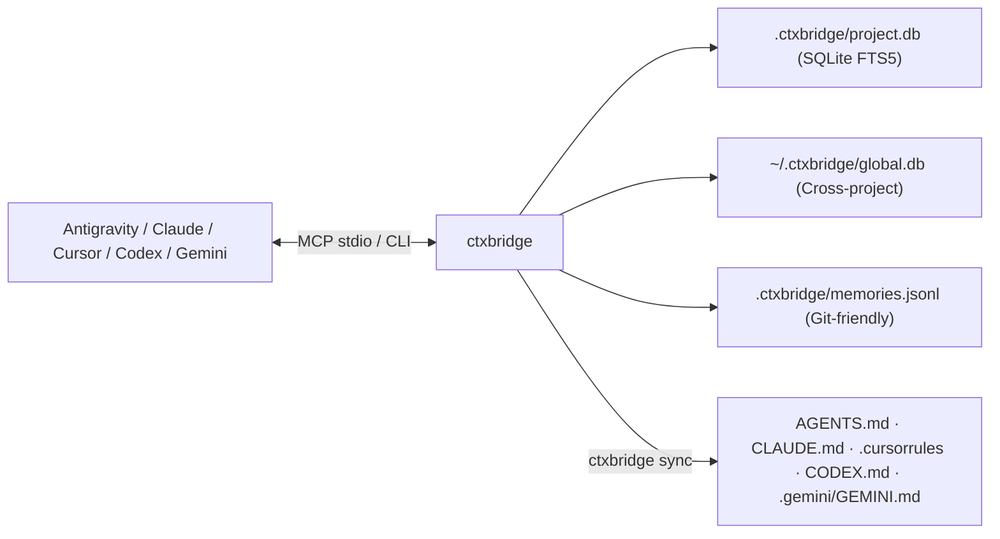

# `ctxbridge`

[](https://github.com/roedyrustam/ctxbridge/actions/workflows/ci.yml)
[](https://github.com/roedyrustam/ctxbridge/actions/workflows/release.yml)
[](LICENSE)

**Local-first cross-agent memory & context bridge (CLI + MCP server)** written in Rust.

`ctxbridge` solves **context amnesia** and **rule fragmentation** when switching between AI coding tools (**Antigravity**, **Claude Code**, **Cursor**, **OpenAI Codex CLI**, **Gemini CLI**).



## Why `ctxbridge`?

| | Cloud Memory SaaS | `ctxbridge` |
| :--- | :--- | :--- |
| **Latency** | 200–800 ms network round-trip | **`< 10 ms`** single static Rust binary |
| **Privacy** | Code & decisions sent to external servers | **100% local-first** (SQLite on your disk) |
| **Offline** | Broken without internet / API keys | **Works offline** with FTS5 + BM25 + recency |
| **Team Sync** | Proprietary cloud sync | **Git-native** (`.ctxbridge/memories.jsonl` + `rules.md`) |
| **Token Cost** | Dumps huge raw context | **`< 500` token Handoff Capsules** |

## Supported AI Tools & Adapter Targets

| AI Tool | Synced Instruction File | MCP Support |
| :--- | :--- | :--- |
| **Antigravity** | `AGENTS.md` / `.gemini/GEMINI.md` | `ctxbridge mcp` (stdio) |
| **Claude Code** | `CLAUDE.md` | `ctxbridge mcp` (stdio) |
| **Cursor** | `.cursorrules` | `ctxbridge mcp` (stdio) |
| **OpenAI Codex CLI** | `CODEX.md` / `AGENTS.md` | `ctxbridge mcp` (stdio) |
| **Gemini CLI** | `.gemini/GEMINI.md` | `ctxbridge mcp` (stdio) |

## Features
- **Single Static Binary**: Zero runtime dependencies, `<10 ms` startup, 100% offline-capable.
- **Dual-Scope SQLite + FTS5**: Project-local (`.ctxbridge/project.db`) and global (`~/.ctxbridge/global.db`) memory stores with hybrid BM25 + priority + recency decay ranking.
- **Git-Friendly JSONL Sync**: Deterministic `.ctxbridge/memories.jsonl` export/import with SHA-256 content deduplication.
- **Universal Adapter (`ctxbridge sync`)**: Non-destructively syncs `.ctxbridge/rules.md` and pinned decisions into `AGENTS.md`, `CLAUDE.md`, `.cursorrules`, `CODEX.md`, and `.gemini/GEMINI.md` using `<!-- ctxbridge:start -->` ... `<!-- ctxbridge:end -->` markers. Supports `--check` for CI drift detection.
- **Handoff Capsule (`ctxbridge capsule`)**: Generates a token-budgeted (`<500` tokens) YAML/Markdown handoff payload for instant context switching between AI tools, with history via `ctxbridge capsules`.
- **MCP Stdio Server (`ctxbridge mcp`)**: Exposes 5 tools and 3 resources over JSON-RPC 2.0.

## Installation

### Pre-built Binaries
Download the latest release archive for Linux (`x86_64`), Windows (`x86_64`), or macOS (`x86_64` / `aarch64`) from [GitHub Releases](https://github.com/roedyrustam/ctxbridge/releases), verify its SHA-256 checksum, and place `ctxbridge` on your `PATH`.

### Build from Source
Requires Rust (`1.75+`):
```bash
git clone https://github.com/roedyrustam/ctxbridge.git
cd ctxbridge
cargo build --release
# Binary at ./target/release/ctxbridge (or install to ~/.cargo/bin):
cargo install --path .
```

## Quick Start
```bash
ctxbridge init
ctxbridge save "Use PostgreSQL RLS for tenant isolation" --kind decision --priority 5 --tags db,security
ctxbridge recall "tenant isolation" --scope all
ctxbridge sync
ctxbridge capsule --goal "Implement billing webhook" --to claude
ctxbridge doctor
```

## CLI Commands (v0.2.0)

Global option: `--project <PATH>` overrides the project root directory (defaults to the nearest `.ctxbridge` or `.git` ancestor).

| Command | Description | Key Flags |
| :--- | :--- | :--- |
| `ctxbridge init` | Initialize `.ctxbridge/` with `project.db`, `rules.md`, and `.gitignore` | — |
| `ctxbridge save <content>` | Save a decision, rule, fact, lesson, or todo | `--kind`, `--title`, `--tags`, `--priority 1..5`, `--global`, `--agent` |
| `ctxbridge recall [query]` | Search memories with FTS5 + BM25 + priority + recency | `--scope all\|project\|global`, `--kind`, `--tag`, `--limit`, `--json` |
| `ctxbridge forget <id>` | Permanently delete a memory by UUID or unique prefix | `--global` |
| `ctxbridge sync` | Sync `rules.md` & pinned memories to all AI instruction files | `--existing-only`, `--check` |
| `ctxbridge capsule` | Generate a token-budgeted Handoff Capsule | `--goal`, `--to`, `--budget`, `--format yaml\|markdown` |
| `ctxbridge capsules` | List recently generated Handoff Capsules | `--limit`, `--json` |
| `ctxbridge promote <id>` | Promote a project memory to the global store | — |
| `ctxbridge export` | Export project memories deterministically to `.ctxbridge/memories.jsonl` | — |
| `ctxbridge import` | Import and deduplicate memories from `.ctxbridge/memories.jsonl` | — |
| `ctxbridge status` | Show project/global store statistics and sync state | `--json` |
| `ctxbridge doctor` | Run health, SQLite integrity, `.gitignore`, and sync diagnostics | `--json` |
| `ctxbridge mcp` | Start the JSON-RPC 2.0 MCP server over `stdin`/`stdout` | — |

See [DOCUMENTATION.md](DOCUMENTATION.md) for detailed flag defaults and technical specifications.

## MCP Server (`ctxbridge mcp`)

### Configuration Example
```json
{
  "mcpServers": {
    "ctxbridge": {
      "command": "ctxbridge",
      "args": ["mcp"]
    }
  }
}
```

### Exposed Tools
- `memory_save` — Save a `decision`, `rule`, `fact`, `lesson`, or `todo` to `project` or `global` scope.
- `memory_recall` — Hybrid FTS5 + BM25 + priority + recency search (`scope`: `all` | `project` | `global`).
- `capsule_generate` — Produce a token-budgeted Handoff Capsule (`yaml` | `markdown`).
- `context_sync` — Sync `.ctxbridge/rules.md` and pinned memories to repo instruction files (`existing_only`).
- `memory_forget` — Permanently delete a memory by UUID or prefix (`scope`: `project` | `global`).

### Exposed Resources
- `ctxbridge://rules` (`text/markdown`) — Canonical `.ctxbridge/rules.md` synced across AI coding assistants.
- `ctxbridge://status` (`application/json`) — Project and global store statistics, kind breakdown, and adapter sync state.
- `ctxbridge://capsule/latest` (`text/plain`) — Most recently generated Handoff Capsule for the project.

## Documentation & Architecture
- [Technical Documentation](DOCUMENTATION.md) — Storage layout, CLI reference, and MCP protocol details.
- [Product Requirements (PRD)](PRD.md) — Problem statement, scope, and non-functional requirements.
- [Entity Relationship Diagram (ERD)](ERD.md) — SQLite schema, FTS5 indexing, and ranking strategy.
- [Changelog](CHANGELOG.md) — Release history (`v0.1.0` → `v0.2.0`).

## License
Released under the [MIT License](LICENSE).
